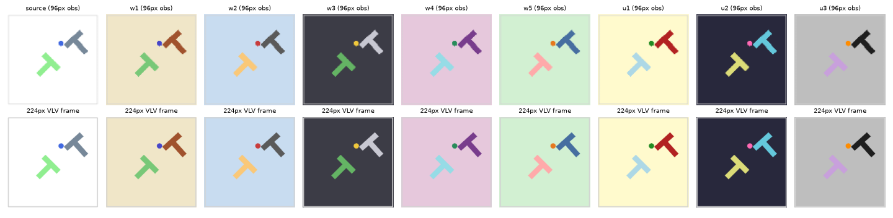

# Seed2Scale-mini: what does a self-evolving data engine actually buy you?
# Seed2Scale-mini: một data engine tự tiến hóa thực sự mang lại điều gì?

A scaled-down, paper-faithful replication of **Seed2Scale** (Tai et al., arXiv:2603.08260) on the
**PushT** simulator, built to run on one GPU (molab, RTX Pro 6000 96 GB).
Bản tái hiện thu nhỏ, bám sát paper **Seed2Scale** (Tai et al., arXiv:2603.08260) trên mô phỏng **PushT**,
thiết kế để chạy trên một GPU (molab, RTX Pro 6000 96 GB).



## Questions / Câu hỏi

1. From **4 seed demos**, does the target model (**SmolVLA**) keep improving as self-evolution iterates? *(paper Fig. 5)*
   Từ **4 demo seed**, model mục tiêu (**SmolVLA**) có tiếp tục tốt lên qua các vòng tự tiến hóa không? *(Hình 4)*
2. What does the **VLM verifier** add on top of a plain success check? *(paper Sec. IV-G, "SuperTiny⁻")*
   **VLM verifier** đóng góp gì thêm so với chỉ kiểm tra thành công? *(mục IV-G, "SuperTiny⁻")*
3. Without any filter, does self-training **collapse**? *(the paper's motivation; not ablated there)*
   Không lọc gì cả thì quá trình tự học có **sụp đổ** không? *(động lực của paper; paper không làm ablation này)*
4. Do **Parallel Worlds** (same physics, new appearance) transfer to **unseen** worlds? *(paper Table I)*
   **Parallel Worlds** (cùng vật lý, khác hình ảnh) có giúp chuyển sang thế giới **chưa thấy** không? *(Bảng I)*
5. What does the VLV actually reward (smoothness? length?) *(paper Fig. 8, Table IV)*
   VLV thật sự thưởng cho điều gì (độ mượt? độ dài?) *(Hình 7, Bảng IV)*

## Faithfulness / Mức độ bám sát paper

Checked against the arXiv v2 PDF (figure numbers follow the PDF). / Đã đối chiếu với bản PDF arXiv v2 (số hình theo bản PDF).

| Component | Paper | Here / Ở đây |
|---|---|---|
| Seeds | 4 teleop demos at the 4 workspace corners | 4 `lerobot/pusht` demos whose T-block starts nearest each corner (found from the first frame) |
| Collector SuperTiny | ResNet-18 + 1×1 conv, T5-small, state MLP, query decoder, K=30, temporal ensembling; 48M = 12M trainable + 36M (Fig. 1), decoder width 128 (Fig. 2: "30x128"), 3 cameras | same design, 51M = 15.7M trainable + 35M frozen T5; decoder width 256 (chosen before the PDF was checked; kept so run 2 stays consistent); 1 camera (PushT has one view) |
| Verifier | success gate, then frozen **Qwen3-VL-32B** scores 0–10 with task + rollout video + seed reference video; γ fixed a priori; outputs Result/Score/Reason (Fig. 8 shows Score 9 accepted, 3 rejected) | same; rubric and γ=7 fixed in `s2s/verifier.py` / `s2s/config.py` before any run |
| Self-evolution | D(i+1) = D(i) ∪ D_silver(i), 8 iterations | same; N_rollout = 256 (not reported) |
| Target | SmolVLA, "trained from scratch" per iteration, 100k steps, AdamW 3e-4, batch 16 | SmolVLA, pretrained SmolVLM2 backbone + new action expert per dataset, AdamW 3e-4, batch 16, **20k steps** (budget) |
| Parallel Worlds | 10 worlds (some 3DGS) + 3 unseen, replay actions, feasibility check, VLV filter | 5 seen + 3 unseen **color** worlds, exact action replay (physics identical), success re-check, VLV filter |
| Tasks / robots | 4 Agibot A2 + 2 GR-1 tasks, real robot | PushT only, simulation only |

Why "from scratch" = pretrained backbone: in LeRobot 0.7.0, `load_vlm_weights=false` randomly
initialises the whole VLM *and* keeps it frozen; LeRobot warns this is "unlikely to yield good results".
Vì sao "from scratch" = backbone pretrained: trong LeRobot 0.7.0, `load_vlm_weights=false` khởi tạo ngẫu
nhiên toàn bộ VLM *và* đóng băng nó; chính LeRobot cảnh báo cách này "unlikely to yield good results".

## Run 1 finding: 4 seeds do not bootstrap on PushT / Phát hiện lần chạy 1: 4 seed không khởi động được trên PushT

With the paper's 4 corner seeds, 8 iterations × 256 rollouts gave **0/2,048 successes** for Seed2Scale*
and **1/2,048** for SuperTiny⁻ (best coverage 0.81 and 0.96; mean 0.06–0.17). The collector memorised the
demos (training loss 0.005) and the self-evolution loop never started, so the VLV was never even called.
Self-evolution needs a collector with small but **non-zero** early success (the paper reports < 15%); on
PushT, 4 demos do not provide it. Run 1 also exposed a bug: model initialisation was not seeded, so arms
differed by luck (mean coverage 0.08 vs 0.16 at iteration 0 on identical data). Both arms are kept in
`runs/` (and on the Hub) as a negative result.
Với 4 seed ở 4 góc như paper, 8 vòng × 256 rollout cho **0/2.048 thành công** ở Seed2Scale* và **1/2.048**
ở SuperTiny⁻ (độ phủ cao nhất 0,81 và 0,96; trung bình 0,06–0,17). Collector học thuộc các demo (loss 0,005)
và vòng tự tiến hóa không bao giờ khởi động, nên VLV chưa từng được gọi. Tự tiến hóa cần collector có
success ban đầu nhỏ nhưng **khác 0** (paper báo < 15%); trên PushT, 4 demo không đủ. Lần chạy 1 cũng lộ ra
một lỗi: khởi tạo model không cố định seed, nên các nhánh khác nhau do may rủi (độ phủ trung bình 0,08 so
với 0,16 ở vòng 0 trên cùng dữ liệu). Cả hai nhánh được giữ trong `runs/` (và trên Hub) làm kết quả âm tính.

Run 2 changes / Thay đổi ở lần chạy 2:
- fixed random seeds for model init and training / cố định seed ngẫu nhiên khi khởi tạo và train;
- a `calibrate` stage measures iteration-0 collector success with 4, 8, 16, 32 seeds and the pipeline uses
  the smallest count reaching 3% (corners first, then farthest-point spread) / giai đoạn `calibrate` đo
  success vòng 0 với 4, 8, 16, 32 seed và pipeline dùng số nhỏ nhất đạt 3% (góc trước, rồi trải đều);
- fewer collector steps (4000 / 2000) to reduce memorisation / ít bước train collector hơn để giảm học thuộc;
- each seed count writes to its own `runs_n<N>/`, `results_n<N>/` so runs never mix / mỗi số seed ghi vào
  thư mục riêng để các lần chạy không trộn lẫn.

## Results: self-evolution did not improve the collector / Kết quả: tự tiến hóa không cải thiện collector

**Negative result.** With 32 seeds (run 2) and four follow-up experiments, no setting made the SuperTiny collector's
success rise across iterations beyond the noise (~±2 pp). Full details: [`auto-research/s2s-bootstrap/REPORT.md`](auto-research/s2s-bootstrap/REPORT.md).
**Kết quả âm tính.** Với 32 seed và bốn thí nghiệm tiếp theo, không cấu hình nào làm success của collector tăng qua
các vòng vượt mức nhiễu (~±2 điểm). Chi tiết ở báo cáo trên.

| Experiment | Success % by iteration | \|D\| | Change, first → last two |
|---|---|---|---|
| Run 2, `s2s` (warm start, γ=7) | 7.0 7.0 4.3 2.7 3.1 3.9 1.2 1.6 | 32→42 | −5.5 pp |
| Run 2, `gate_only` | 5.1 8.6 6.2 6.6 5.9 7.8 3.9 4.3 | 32→156 | −3.5 pp |
| Run 2, `no_filter` | 3.5 0.8 0.8 1.2 0.8 0.4 0.4 0.4 | 32→2080 | collapse / sụp đổ |
| E1 `s2s`, retrain from scratch, γ=7 | 5.5 5.9 9.8 0.0 5.9 5.5 | 34→38 | +0.2 pp |
| E3 `s2s`, scratch, γ=6 | 5.5 10.2 6.2 0.0 0.0 6.2 | 42→81 | −2.3 pp |
| E4 `gate_only`, scratch | 5.5 0.0 5.9 5.9 6.2 6.2 | 46→108 | +0.8 pp |

What we learned / Điều rút ra:
1. **No filter → collapse** (Q3): training on all rollouts drives success from 3.5% to 0.4%. Filtering is necessary.
   **Không lọc → sụp đổ**: train trên mọi rollout kéo success từ 3,5% xuống 0,4%. Lọc là cần thiết.
2. **The run-2 decline was over-training**, not the data: retraining from scratch removes it (H1, weak support).
   **Sự suy giảm ở lần chạy 2 là do train quá mức**, không phải do dữ liệu: train lại từ đầu xóa được nó.
3. **More data does not help**: γ=6 (E3) and gate-only (E4) grow the dataset 2–2.3×, success stays at ~6% (H2/H3
   refuted). / **Thêm dữ liệu không giúp**: dữ liệu tăng 2–2,3 lần, success vẫn ~6%.
4. **No measurable VLV benefit** (Q2): E3 vs E4 differ by 3 pp, inside the noise. The VLV scores are coarse (3/6/10).
   **Không đo được lợi ích của VLV**: chênh lệch nằm trong nhiễu; VLV cho điểm thô (3/6/10).
5. **Training variance dominates**: the same 46 trajectories gave 0.0% and 5.9% in two trainings.
   **Phương sai khi train lấn át**: cùng 46 quỹ đạo cho 0,0% và 5,9% ở hai lần train.
6. **Target model** (Q1): SmolVLA trained on the 32 seeds scores 0/100 in the source world and 0% in 3 unseen worlds,
   so the scaling curve and Parallel-Worlds questions (Q1, Q4, Q5) remain open.
   **Model mục tiêu**: SmolVLA train trên 32 seed đạt 0/100; các câu hỏi Q1, Q4, Q5 còn bỏ ngỏ.

This does not refute the paper: it runs on real robots with an unpublished collector training recipe; here the
mechanism fails on PushT under the recipe we could infer.
Kết quả này không bác bỏ paper: paper chạy trên robot thật với cách train collector không công bố; ở đây cơ chế không
hoạt động trên PushT với cách train mà ta suy ra được.

## Arms and target models / Các nhánh và model mục tiêu

| Arm | Filter | Paper name |
|---|---|---|
| `s2s` | success gate + VLV | Seed2Scale* |
| `gate_only` | success gate | SuperTiny⁻ |
| `no_filter` | none | (extra) |

Targets, trained in this priority order so a cut-off run still answers the main questions:
Các model mục tiêu, train theo thứ tự ưu tiên để nếu bị dừng giữa chừng vẫn trả lời được câu hỏi chính:
`seed_only`, `s2s_i8`, `gate_only_i8`, `s2s_full_i8` (+ Parallel Worlds), `no_filter_i8`, `s2s_i4`, `s2s_i2`.
Each is evaluated on 100 fixed seeds in the source world and in 3 unseen worlds (Wilson 95% CIs).
Mỗi model được đánh giá trên 100 seed cố định ở thế giới gốc và 3 thế giới chưa thấy (khoảng tin cậy Wilson 95%).

## Run on molab / Chạy trên molab

1. Push this repo to GitHub; open `molab_pipeline.py` in molab with a GPU attached.
   Đẩy repo lên GitHub; mở `molab_pipeline.py` trên molab, bật GPU.
2. Fill in the repo URL, a private HF repo name and an HF **write** token; click **Install**.
   Điền URL repo, tên repo HF riêng tư và token HF quyền **ghi**; bấm **Install**.
3. Start with stages `setup,smoke`: it checks the simulator, the VLV server and times SmolVLA training.
   Chạy trước `setup,smoke`: kiểm tra mô phỏng, server VLV và đo tốc độ train SmolVLA.
4. Then `evolve,worlds,targets,analyze`. Every stage is resumable and mirrored to the HF repo,
   so after molab's 12 h limit you just start again.
   Sau đó `evolve,worlds,targets,analyze`. Mọi giai đoạn chạy tiếp được và được sao lưu lên repo HF,
   nên sau giới hạn 12 giờ của molab chỉ cần bấm chạy lại.

Locally / Trên máy: `pip install -e . && pytest -q` (17 CPU tests, no GPU / không cần GPU).

## Layout / Cấu trúc

```
s2s/config.py          every setting, tagged PAPER or DEVIATION / mọi cấu hình, gắn nhãn PAPER hoặc DEVIATION
s2s/worlds.py          PushT worlds: same physics, new colors / các thế giới PushT
s2s/seeds.py           4 corner seed demos / 4 demo seed ở 4 góc
s2s/supertiny.py       SuperTiny collector + training + temporal ensembling (Eq. 1-3)
s2s/rollout.py         batched rollouts, exact replay / rollout theo batch, chạy lại chính xác
s2s/verifier.py        success gate + Qwen3-VL verifier client (Eq. 4-6)
s2s/evolve.py          self-evolution loop with resume (Eq. 5-7) / vòng tự tiến hóa
s2s/parallel_worlds.py projection into seen worlds (Eq. 8-10) / chiếu sang các thế giới
s2s/export.py          trajectories -> LeRobotDataset
s2s/train_target.py    SmolVLA via lerobot-train
s2s/eval_target.py     evaluation with LeRobot's rollout loop / đánh giá bằng vòng rollout của LeRobot
s2s/analyze.py         figures and tables / hình và bảng
s2s/pipeline.py        resumable orchestration + HF sync / điều phối chạy tiếp được + đồng bộ HF
molab_pipeline.py      marimo notebook for molab / notebook marimo cho molab
```

## Known limitations / Hạn chế đã biết

- PushT is 2-D and visually simple; results show the *mechanism*, not the paper's robot numbers.
  PushT là bài 2D, hình ảnh đơn giản; kết quả cho thấy *cơ chế*, không phải các con số robot của paper.
- Parallel Worlds here change colors only (no new objects, layouts or cameras), and seeds cannot be
  projected because the dataset lacks their exact start states.
  Parallel Worlds ở đây chỉ đổi màu (không đổi vật thể, bố cục hay camera), và seed không chiếu được vì
  dataset không có trạng thái đầu chính xác của chúng.
- SmolVLA trains 20k steps instead of 100k, and the scaling curve uses 4 points instead of 8.
  SmolVLA train 20k bước thay vì 100k, và đường mở rộng dùng 4 điểm thay vì 8.
- One seed per configuration (no repeated runs), so differences inside the CIs are not claims.
  Mỗi cấu hình chạy một lần (không lặp lại), nên chênh lệch nằm trong khoảng tin cậy không được coi là kết luận.

## Reference / Tài liệu tham khảo

C. Tai et al., *Seed2Scale: A Self-Evolving Data Engine with Parallel Worlds Expansion for Scalable Robot
Learning*, arXiv:2603.08260, 2026. Project page: https://terminators2025.github.io/Seed2Scale.github.io
